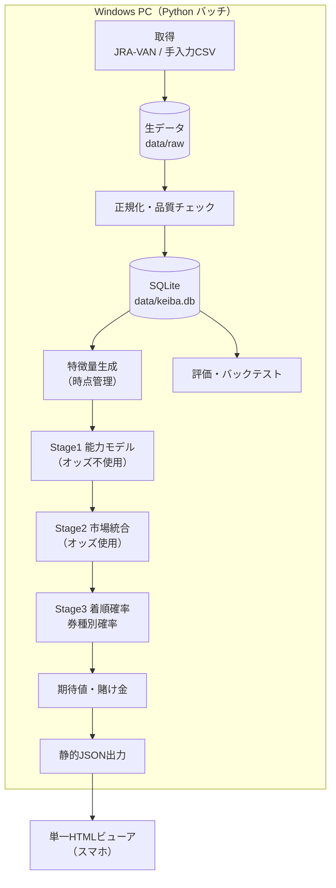
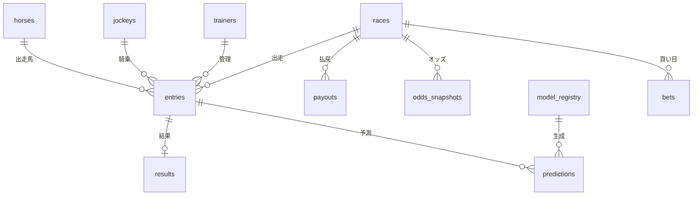

# 競馬予測システム 設計書

| 項目 | 内容 |
|---|---|
| 版 | v0.1（AIによる下書き） |
| 作成日 | 2026-10-19 |
| 対象 | inaguma48-maker/keiba_ai_new |
| 状態 | 要決定事項あり（§14） |

表記: **初期案** = 設計上の仮の値（検証や決定で変える） / **要確認** = 外部の事実で未確認のもの / **【要決定】【要記入】** = オーナーが決める・記入する項目。

---

## 0. 結論

1. **現行アプリの予測値は、勝率の推定として根拠がない。** 学習データはすべて合成データで、実際のレース結果では一度も検証されていない。取り込んだ実レースには過去成績が入らず、オッズからの逆算値と固定値が入る（§2 で実測）。
2. **新しい設計は「実データ → オッズを使わない能力モデル → 市場オッズとの統合 → 期待値と賭け金 → 静的配信」の5層構成にする。** 学習とデータ取得は PC の Python バッチで行い、閲覧はスマホ向けの単一 HTML で行う（公開先は GitHub Pages を想定。公開範囲は D6 で決める）。
3. **目標は的中率ではなく、市場（オッズから逆算した確率）より正確な確率を作ること。** 控除率があるため、市場と同じ精度の確率で買っても期待回収率は払戻率（単勝なら80%）に近づくだけになる。市場を上回ることを検証で確認できるまで、実際の購入には進まない（§8.3 Go/No-Go）。
4. **最初に決めること:** データ取得元（推奨: JRA-VAN データラボ）。その次が資金ルールと公開範囲（§14）。

---

## 1. 目的とスコープ

**目的:** JRA のレースについて、各馬の勝率・複勝率と券種別の組合せ確率を推定し、期待値が1を超える買い目と賭け金を、根拠（確率・オッズ・データの時点）付きで示す。

**成功指標**（詳細は §8）: ①確率の質（対数損失が市場ベースラインより小さい）、②検証済みの購入ルールでの回収率とその信頼区間。

| 区分 | 内容 |
|---|---|
| MVP の対象 | JRA 平地競走、単勝・複勝 |
| 拡張の対象 | 馬連・ワイド・馬単・3連複・3連単（実オッズを取得できる場合だけ） |
| 対象外 | 地方競馬・海外競馬、自動購入（IPAT 連携）、レース映像・中継シミュレーション |

障害競走と新馬戦は、過去走データが少なく条件も特殊なので、MVP では予測しない（D2）。

---

## 2. 現状分析（As-Is）

2026-10-19 にこのリポジトリのコードを読み、実行して確認した事実。

| # | 事実 | 確認した場所・方法 | 影響 |
|---|---|---|---|
| A1 | 学習データはすべて合成データ。乱数シードが固定なので、「再学習」ボタンを押しても毎回同じデータで学習し直すだけ | `src/data.py:82`、`src/predictor.py:84-86`、`app.py:164`。2回生成して一致することを確認 | 実際のレースでの精度は不明（未検証） |
| A2 | 取り込んだ実レースの過去成績系の特徴量は、オッズからの逆算値（`88 + 15/オッズ`）と固定値（過去勝率0.3、馬場適性0.85、年齢4、調教師勝率0.18 など） | `src/jra_importer.py:130-147`、`:281-298` | 馬ごとに違う入力は、オッズ、騎手（上位騎手か否かの2値）、斤量・馬体重（解析できた場合）だけ。市場より多い情報をモデルが持てない |
| A3 | A2 と同じ条件の入力で予測すると、単勝88.8倍（市場確率1.3%）の馬に勝率12.6%、期待値11.2 が付く | 8頭立て・騎手と斤量は全頭同じ・オッズ 3.1/5.4/7.9/12.3/18.6/25.0/41.2/88.8 の入力で実測 | 大穴を極端に過大評価した買い目が推奨される |
| A4 | サンプルのジャパンカップでは、入力上の能力値が最も高く単勝1.8倍の1番に勝率8.4%、8.4倍の4番に26.1% が付く | `get_sample_races()` の1レース目を予測して実測 | 合成データにない傾向の入力で、モデルの出力が不安定 |
| A5 | 取得や解析に失敗すると、固定の出馬表（シリウスS・スプリンターズS）を何も知らせずに返し、API は success を返す | `src/jra_importer.py:149-163`、`:348-370`、`:394-418`。本環境では JRA・netkeiba への接続が失敗し（プロキシ 403）、固定データが返ることを確認 | 利用者は実データか固定データかを見分けられない。運用上もっとも危険 |
| A6 | 「自動検出」は最新レースを探すのではなく、固定の3つの URL を取得するだけ | `src/jra_importer.py:378-382` | 新しい開催に追随しない |
| A7 | 「馬番 馬名 騎手 斤量 オッズ」の順のテキストでは、斤量57.0 がオッズとして読まれ、斤量は既定値56.0 になる | `src/jra_importer.py:112-113`、`:120-121`。実測 | 期待値計算の入力が誤る |
| A8 | 馬単・3連複の確率とオッズは近似式と架空の推定値（例: 馬単オッズ = 2頭の単勝オッズの積 × 0.7） | `src/strategy.py:66-67`、`:87-88` | 連系馬券の期待値に意味がない |
| A9 | 「AI予想信頼度」は本命の勝率 × 250 で、校正の根拠がない | `src/strategy.py:101` | 表示が誤解を招く |
| A10 | race_id が取り込みのたびに乱数で振られ、同じレースが重複保存される。DB の56レースのうち、同名のシリウスSが50件 | `src/jra_importer.py:165`、`:335`。`racing_app.db` を集計 | 履歴が重複し、評価に使えない |
| A11 | DB に結果・払戻・オッズ履歴のテーブルがない | `src/db.py:18-57` | バックテスト（過去データでの検証）ができない |
| A12 | テスト16件はすべて成功するが、外部取得のテストは固定データへのフォールバックで成功している。テストを実行すると git 管理下の `racing_app.db` が書き換わる | `tests/test_app.py:144-168`、`:36-48`。本環境で実行して確認 | テストが取得失敗を検知できない。テストのデータが DB に混ざる |

**引き継げるもの:** Flask・LightGBM の実行環境、レース内の相対特徴量という考え方（`src/data.py:68-72`）、競馬場プロファイル（`src/models.py:28-153`、値の出典は未確認）、テキスト貼り付けで取り込む UI。

---

## 3. 要件

### 3.1 機能要件

| ID | 要件 |
|---|---|
| F1 | 過去レースの出馬表・結果・払戻を取り込み、重複なく保存する |
| F2 | 開催週の出馬表・枠順・当日情報（馬場状態、出走取消、馬体重）・オッズを取り込む |
| F3 | 各馬の勝率・2着内率・3着内率と、券種別の組合せ確率を算出する |
| F4 | 期待値と賭け金を算出し、購入候補を示す（購入は手動） |
| F5 | すべての予測と購入候補を記録し、結果の確定後に自動で精算する（ペーパートレード） |
| F6 | 確率の質と収支を定期的に評価し、市場ベースラインと比べる |
| F7 | スマホでレース一覧・予測・買い目・成績を見られる |

### 3.2 非機能要件

| ID | 区分 | 要件 |
|---|---|---|
| N1 | 正確性 | 取得・解析に失敗したレースは「予測停止」にし、代わりのデータで埋めない |
| N2 | 再現性 | 予測ごとに入力データの時点・モデルの版・設定を記録し、同じ結果を再計算できる |
| N3 | リーク防止 | 予測の時点で手に入らない情報を特徴量に使わない（§6.1） |
| N4 | 監視 | ジョブの成否とデータ品質チェックの結果を記録し、失敗を通知する |
| N5 | 費用 | 常時稼働のサーバーを持たない（PC バッチ＋静的ホスティング） |
| N6 | 秘密情報 | 利用キーなどをリポジトリに含めない |
| N7 | 表示 | スマホ幅（360px 程度）で、横スクロールなしに主要な情報が読める |

---

## 4. 全体アーキテクチャ（To-Be）



| 層 | 役割 | 主な出力 |
|---|---|---|
| 取得 | 取得元ごとのアダプタで取得し、生データを加工せずに保存する | `data/raw/{取得元}/{日付}/` |
| 正規化・品質 | 共通スキーマに変換し、品質チェックでレースごとに合否を判定する | DB テーブル、品質チェック結果 |
| 特徴量 | 予測の時点より前の情報だけで特徴量を作る | 特徴量テーブル |
| モデル | Stage1 → 2 → 3 の順に確率を算出する | `predictions` |
| 買い目 | 期待値・購入判定・賭け金 | `bets`（paper / real） |
| 評価 | 確率の質・収支・市場との比較 | 週次レポート |
| 配信 | ビューア用の JSON を出力して公開する | `web/data/*.json` |

**この配置にした理由:** 学習と大量データの取得は静的構成では実行できないので、PC バッチと静的ビューアに分けた。PC を Windows にしたのは、git 履歴に Windows での直接実行に対応したコミット（45d851b）があり、推奨する取得元の JV-Link が Windows 用だから。

### 4.1 ディレクトリ構成（案）

```
keiba_ai_new/
├── docs/DESIGN.md         # 本書
├── keiba/                 # 新パイプライン（Python）
│   ├── config.py          # 払戻率・閾値・資金ルールなどの設定値
│   ├── ingest/            # 取得元アダプタ（jravan / manual_csv）
│   ├── store/             # スキーマ・DB アクセス（SQLite）
│   ├── quality/           # データ品質チェック
│   ├── features/          # 時点管理付きの特徴量
│   ├── model/             # stage1 / stage2 / stage3
│   ├── betting/           # 期待値・賭け金
│   ├── evaluate/          # 指標・バックテスト・レポート
│   ├── publish/           # 静的 JSON の出力
│   └── jobs/              # J0〜J8 の起動口
├── web/index.html         # スマホ向け単一 HTML ビューア
├── web/data/              # 出力 JSON（公開するかは D6）
├── data/                  # git 管理外: raw/ と keiba.db
├── models/                # git 管理外: 学習済みモデル
├── app.py, src/, templates/, static/   # 現行アプリ（移行が終わるまで残す。扱いは D7）
└── tests/
```

---

## 5. データ設計

### 5.1 データ取得元

| 候補 | 内容 | 長所 | 短所・リスク |
|---|---|---|---|
| **JRA-VAN データラボ（推奨）** | JRA 公式のデータ提供サービス。月額2,090円（税込、2026-10-19 時点の公式ページの記載）。JV-Link（Windows 用、無料）経由で取得する | 過去データが構造化されている。時系列オッズがある（単勝・複勝・枠連・馬連と記載あり ※） | 有料。Windows が必要。Python から JV-Link を呼ぶ方式は技術検証が必要。データの再配布の可否は要確認 |
| Web スクレイピング（JRA 公式サイト、netkeiba など） | 現行の方式 | 費用がかからない | 利用規約上の可否は要確認。HTML の変更で壊れる（A5〜A7 の原因）。アクセス負荷への配慮が必要 |
| 手入力・CSV 貼り付け | 現行のテキスト取り込みを拡張する | いつでも使える | 過去データの大量取得には向かない。当日の補完と障害時の代替手段として残す |

※ JRA-VAN のソフト紹介ページの記載（検索結果の要約で確認。原文と公式のデータ仕様書は未確認）。

**推奨:** JRA-VAN を主、手入力 CSV を補助にする（D1）。スクレイピングは、規約の確認が取れるまで新しく実装しない。

### 5.2 データの時点

| データ | 確定・公表のタイミング | 予測での扱い |
|---|---|---|
| 過去走の成績・払戻 | 各レースの確定後 | 対象レース日の前日までに確定した分だけ使う |
| 出走馬 | 原則、開催直前の木曜の出馬投票で決まる（JRA 規程。変則日程は要確認） | J2 で取得 |
| 枠順 | 発売開始の前日に確定（用語集の記載。公表時刻は要確認） | J3 で取得 |
| 馬場状態・天候 | 当日発表。途中で変わることがある | 判断時点の最新値を使う |
| 馬体重 | 当日の発走前に発表（公表時刻は要確認） | 判断時点で取れていれば使う。欠損を許す |
| 出走取消・競走除外 | 随時 | 判断時点で除外し、確率を再正規化する |
| オッズ | 発売中に変動し、締切後に確定 | 判断時点のスナップショットを使う。学習では確定オッズで代用し、差は運用で計測する（§13 R4） |

### 5.3 キー設計

- **race_key**: `YYYYMMDD` ＋ 場コード2桁 ＋ レース番号2桁。例: 2026-09-27 中山11R → `202609270611`。JRA では同じ競馬場で同じ日に開催は1つなので一意になる。場コードは 01札幌 02函館 03福島 04新潟 05東京 06中山 07中京 08京都 09阪神 10小倉（JRA-VAN・netkeiba で共通。取り込みの実装時にコード表で確認する）。現行の乱数 ID（A10）はこれに置き換える。
- **horse_id**: 取得元の馬 ID（JRA-VAN なら血統登録番号）。馬名は再使用されることがあり表記ゆれもあるので、キーにしない。
- 騎手・調教師も取得元の ID をキーにする。

### 5.4 テーブル設計



| テーブル | 主キー | 主な列 |
|---|---|---|
| races | race_key | 開催日、場コード、回・日、R、レース名、格付、芝／ダート／障害、距離、内回り・外回り、条件（クラス・年齢・性別・負担重量の方式）、発走時刻、天候、馬場状態、払戻率区分（通常／スーパープレミアムなど）、取得元、取得時刻 |
| entries | race_key, horse_no | 枠番、horse_id、騎手 ID、調教師 ID、性、年齢、斤量、馬体重、増減、状態（出走／取消／除外） |
| results | race_key, horse_no | 確定着順、着順区分（完走／中止／失格／降着）、走破タイム、着差、通過順、上がり3F、確定単勝オッズ、人気 |
| payouts | race_key, bet_type, combination | 払戻金（100円あたり）、人気 |
| odds_snapshots | race_key, bet_type, combination, captured_at | オッズ（複勝・ワイドは下限と上限）、発走までの分数、取得元 |
| horses / jockeys / trainers | 各 ID | 名前、生年、性、父・母・母父、所属 |
| predictions | race_key, horse_no, model_version, created_at | Stage ごとの勝率・2着内率・3着内率、入力スナップショットの ID |
| bets | bet_id | race_key、model_version、券種、組合せ、確率、判断時のオッズ、期待値、賭け金、区分（paper / real）、払戻、精算時刻 |
| model_registry | model_version | git コミット、学習期間、特徴量セットのハッシュ、パラメータ、評価指標、状態（候補／稼働／退役） |
| job_runs | run_id | ジョブ名、開始・終了時刻、結果、件数、メッセージ |

### 5.5 データ品質チェック

| ID | チェック内容 | 不合格のとき |
|---|---|---|
| Q1 | 馬番・horse_id の重複がない。必須項目が欠けていない | そのレースを予測停止 |
| Q2 | 出走頭数 = 出馬表の頭数 − 取消・除外 | 予測停止 |
| Q3 | 単勝オッズの逆数の和が理論値の近く（払戻率80%なら約1.25。端数処理があるので完全には一致しない。閾値の初期案は 1.20〜1.40） | オッズを再取得し、それでも不合格なら予測停止 |
| Q4 | 判断時のオッズが十分新しい（許容する経過時間は D9 に連動） | 予測停止 |
| Q5 | 確率の整合（単勝確率の和 = 1、複勝確率の和 = 払戻対象の頭数） | 予測停止。ジョブ失敗として通知 |

---

## 6. 特徴量設計

### 6.1 リーク防止ルール

| ID | ルール |
|---|---|
| L1 | 特徴量は、対象レース日の前日までに確定した情報だけから作る（同じ日の先行レースは使わない） |
| L2 | 騎手勝率などの集計値は時点付きで計算する（期間全体で集計した値を使わない） |
| L3 | 当該レースの確定オッズ・人気・着順・タイム・上がりを、そのレースの特徴量に入れない |
| L4 | 学習・検証・テストは時間順に分ける。ランダムには分けない。同じレースの馬を別の組に分けない |
| L5 | 当日情報（馬場、馬体重、取消、オッズ）は判断時点のスナップショットを保存し、あとで再現できるようにする |

### 6.2 特徴量一覧

| 区分 | 特徴量の例 | 優先度 |
|---|---|---|
| 能力 | 自前のスピード指数（走破タイムを競馬場・距離・馬場状態ごとの基準タイムで補正したもの。算出式は P2 で確定）の直近 N 走の平均・最大・最新値 | P1 |
| 能力 | 直近 N 走の着順・着差（秒）・上がり3F の順位、出走回数、前走からの日数 | P1 |
| 適性 | 同じ条件（芝／ダート、距離帯）での成績 | P1 |
| 適性 | 同じ競馬場・回り・馬場状態での成績 | P2 |
| 条件 | 斤量、前走との斤量差、馬体重と増減、性、年齢、頭数、枠番・馬番 | P1 |
| 人 | 騎手・調教師の直近期間の成績、乗り替わりの有無 | P1 |
| 条件の変化 | 距離の延長・短縮、クラスの昇降、芝とダートの替わり | P2 |
| 展開 | 脚質（通過順から算出）、同じレースの先行馬の数 | P2 |
| 血統 | 父・母父の条件別成績（キャリアの浅い馬向け） | P2 |
| 調教 | 調教タイム（取得元が提供している場合） | P3 |
| レース内の相対値 | 主な特徴量のレース内の偏差と順位 | P1 |
| 市場 | オッズ。Stage1 では使わず、Stage2 だけで使う | — |

出走数が少ない騎手・馬の率は、`(勝利数 + m × 全体平均) / (出走数 + m)` で全体平均に寄せる（m は検証で決める）。

### 6.3 欠損と初出走

- 欠損は欠損のまま渡す（LightGBM は欠損値をそのまま扱える）。平均値などで埋めない。
- 過去走のない馬が含まれるレースは予測するが、画面に「初出走馬あり」と表示する。全頭が初出走の新馬戦は MVP では対象外（D2）。

---

## 7. モデル設計

### 7.1 構成

| 段 | 入力 | 出力 |
|---|---|---|
| Stage1 能力モデル | 特徴量（オッズは使わない） | レース内スコア → 勝率 p |
| Stage2 市場統合 | p と市場確率 q | 最終勝率 P |
| Stage3 着順確率 | P | 2・3着を含む着順の確率、券種別の確率 |

**Stage1 にオッズを入れない理由:** オッズを入れるとモデルが市場をまねる方向に寄り、市場にない情報を学びにくくなる。市場の情報は Stage2 でまとめて使う（Benter（1994）の方式）。

### 7.2 Stage1 能力モデル

| 項目 | 設計 |
|---|---|
| アルゴリズム | LightGBM（既存の依存ライブラリ）。目的関数は lambdarank（グループ = レース） |
| ラベル（初期案） | 1着 = 3、2着 = 2、3着 = 1、それ以外 = 0 |
| 確率への変換 | レース内でスコアをソフトマックス変換する。温度パラメータは検証期間で最尤推定する |
| 比較対象 | 二値分類（1着か否か）＋レース内正規化。検証で良かった方を採用する |
| 早期終了 | 検証期間の NDCG@3 |

### 7.3 Stage2 市場統合（条件付きロジット）

最終勝率 `P_i ∝ p_i^α × q_i^β`（レース内で合計1に正規化する）

- `p_i`: Stage1 の勝率
- `q_i`: 市場確率 `(1/単勝オッズ_i) / Σ_j (1/単勝オッズ_j)`
- `α` と `β` は、Stage1 の学習に使っていない期間で最尤推定する。
- `α` がほぼ0なら、Stage1 には市場以上の情報がないことを意味する。これ自体が重要な評価結果になる。

### 7.4 Stage3 着順確率と券種別確率

- 基本は Harville 式（Plackett–Luce）: `P(i→j→k) = P_i × P_j/(1−P_i) × P_k/(1−P_i−P_j)`
- Harville 式は2・3着の確率で人気馬を過大評価する傾向が報告されているので、2着・3着の計算では `P^λ2`・`P^λ3` に置き換えて正規化する補正を入れる。`λ2`・`λ3` は検証期間の実際の2・3着から推定する。
- 着順の組合せをすべて列挙し（18頭でも1〜3着の並びは4,896通り）、券種ごとに合計する。

| 券種 | 確率の計算 |
|---|---|
| 単勝 | `P_i` |
| 複勝 | 払戻対象の着順までに入る確率。発売開始時の出走予定頭数が8頭以上なら3着まで、5〜7頭なら2着まで、4頭以下は発売なし（JRA の規程） |
| 馬連 / 馬単 | {i, j} が1・2着 / i → j の順 |
| ワイド | i と j がともに3着以内 |
| 3連複 / 3連単 | {i, j, k} が1〜3着 / i → j → k の順 |
| 枠連 | 馬連の確率を枠ごとに合計する |

出走取消・競走除外の馬は除外し、残りの馬で再正規化する。

### 7.5 モデル管理

- `model_version` = 学習日 ＋ git コミットの短縮ハッシュ（例: `20261019-bd243f5`）。
- `model_registry` に学習期間・特徴量セット・パラメータ・評価指標を記録する。
- 新しいモデルは「候補」として一定期間シャドー運用する（予測だけ記録し、買い目には使わない）。Go/No-Go 基準を満たしたら「稼働」に切り替える。旧モデルは残し、設定の変更だけで戻せるようにする。

---

## 8. 評価設計

### 8.1 データの分け方（時間順のウォークフォワード）

```
|------ Stage1 学習 ------|-- Stage2・閾値の検証 --|- テスト -|
                                              → 1か月ずつ後ろへずらして繰り返す
```

- 期間の長さは D4（取得年数）を決めてから確定する。初期案: 検証12か月、テスト1か月、月次でずらす。
- テスト期間は、購入ルールを確定させたあとに1回だけ評価する。閾値をテスト期間で調整しない。

### 8.2 指標

| 区分 | 指標 | 目的 |
|---|---|---|
| 確率の質 | 対数損失（勝ち馬に付けた確率の −log の平均）、Brier スコア | 主な指標。市場との比較に使う |
| 校正 | 予測勝率を10分位に分け、各区間の実際の勝率と比べる | 「20%と予測した馬が本当に20%勝つか」を見る |
| 収支 | 回収率、的中率、購入点数、最大ドローダウン、最長連敗 | 実用性を見る |
| 不確実性 | 回収率の95%信頼区間（レース単位のブートストラップ） | 偶然の当たり外れと区別する |

**ベースライン:** 市場確率 `q`（必ず比べる対象）。参考として「全レースで1番人気の単勝を買う」。

**回収率のばらつき（試算）:** 期待値1の単勝を平均オッズ10倍で買い続けると、1点あたりの回収の標準偏差は約3（= √(10−1)）になる。回収率の標準誤差を5ポイントまで小さくするには約3,600点が必要。少ない点数の回収率で良し悪しを判断しない。

### 8.3 Go/No-Go 基準（初期案。数値は D10 で確定）

| ID | 基準 | 満たさないとき |
|---|---|---|
| G1 | テスト期間で Stage2 の対数損失が市場ベースラインより小さく、その差の95%信頼区間が0を含まない | 買い目の機能に進まない。データ・特徴量の改善に戻る |
| G2 | 校正: 10分位の各区間で、予測勝率の平均が実際の勝率の95%信頼区間に入る | Stage2 の再推定と確率変換を見直す |
| G3 | バックテストの回収率（ルールは検証期間で確定したもの）が100%を超える。信頼区間を必ず併記する | 購入ルールを見直す（テスト期間は使わない） |
| G4 | ペーパートレード（判断時のオッズで判定し、確定払戻で精算）を【要決定】週以上続け、回収率と信頼区間を確認する | 実際の購入はしない |

G1 を満たさないことは、モデルが市場を上回っていないことを意味する。これは失敗ではなく、「買わない」という正しい判断の材料として扱う。

---

## 9. 買い目・賭け金の設計

### 9.1 期待値

| 券種 | 期待値 | 使うオッズ |
|---|---|---|
| 単勝 | `P_win × オッズ` | 判断時の単勝オッズ |
| 複勝 | `P_place × オッズ下限` | 判断時の複勝オッズの下限（保守側） |
| 連系 | `P_組合せ × オッズ` | 判断時の実オッズを取得できた場合だけ。推定オッズは使わない（A8 の廃止） |

払戻率（控除率）は実オッズに織り込まれているので、期待値の計算には使わない。払戻率は品質チェック（Q3）のための設定値としてレースごとに持つ（JRA スーパープレミアムの対象レースは全投票法が80%になるため）。通常の値は次のとおり。

| 券種 | 払戻率（通常） | 確認状況 |
|---|---|---|
| 単勝・複勝 | 80.0% | 解説サイトで券種別の値を確認。JRA 発表の設定値と整合 |
| 枠連・馬連 | 77.5% | 同上 |
| ワイド | 77.5% | JRA 発表の5段階（80.0 / 77.5 / 75.0 / 72.5 / 70.0%）と整合するが、券種との対応は公式表で要確認 |
| 馬単・3連複 | 75.0% | 同上 |
| 3連単 | 72.5% | 同上 |
| WIN5 | 70.0% | 同上 |

なお、払戻率80%の単勝で期待値が1を超えるには、勝率が正規化後の市場確率の約1.25倍以上である必要がある（端数処理は無視した計算）。

### 9.2 購入判定（初期案）

次の条件をすべて満たす馬・組合せを購入候補にする。

1. そのレースの品質チェック（Q1〜Q5）に合格している
2. 期待値 ≥ θ（初期案 1.10。検証期間で決める）
3. 勝率 ≥ p_min（初期案 0.02。大穴ほど推定の誤差が大きいため）
4. 稼働中のモデルで予測している（候補モデルの予測は使わない）

### 9.3 賭け金（分数ケリー）

- ケリー基準の賭け率 `f* = (P × O − 1) / (O − 1)` に係数 κ（初期案 0.25）を掛ける。
- 上限: 1点あたり【要記入】、1レースあたり【要記入】、1日あたり【要記入】。停止条件: 月間の損失が【要記入】円に達したら停止。
- 100円単位に切り捨てる（馬券の購入単位）。0円になったら見送る。
- 同じレースで複数買うときは、合計が1レースの上限を超えないように比例して減らす。
- 自分の購入でオッズが下がる影響は、少額なので MVP では無視する。

### 9.4 購入の扱い

購入は手動で行う。システムは候補・賭け金・根拠を表示し、すべての候補をペーパートレードとして自動で記録する。実際に購入した記録は CSV で取り込めるようにする（任意）。

---

## 10. 運用設計

### 10.1 ジョブ

| ジョブ | きっかけ | 処理 | 失敗したとき |
|---|---|---|---|
| J0 初回取り込み | 手動（初回だけ） | 過去 N 年分（D4）のデータを取り込む | 再実行する |
| J1 週次の差分 | 開催週の明け | 前週の結果・払戻・マスタの更新、予測と買い目の精算 | 通知して再実行する |
| J2 出馬表 | 出走馬の確定後 | 出馬表を取り込み、Stage1 で予測する | 通知し、該当レースを予測停止 |
| J3 枠順 | 枠順の確定後 | 枠順を反映し、Stage1 で再予測する | 同上 |
| J4 当日の朝 | 開催日の朝 | 馬場状態・天候・取消を反映し、再予測する | 同上 |
| J5 発走前 | 各レースの発走 X 分前（D9） | オッズ・馬体重の取得 → 品質チェック → Stage2・3 → 買い目 → JSON の出力と公開 | 該当レースを予測停止（代わりのデータは使わない） |
| J6 結果 | 各レースの確定後 | 結果・払戻を取り込み、精算する | 通知して再実行する |
| J7 週次の評価 | 開催週の明け | 指標の更新、レポート作成、劣化の確認 | 通知する |
| J8 月次の再学習 | 月に1回 | ウォークフォワードで学習 → 評価 → 候補として登録 | 稼働中のモデルを使い続ける |

- どのジョブも、同じ入力で再実行しても結果が重複しないようにする（race_key をキーにした UPSERT で担保する）。
- 実行基盤は Windows のタスクスケジューラ。J5 は開催日に常駐し、発走時刻表から各レースの処理を起動する。

### 10.2 監視

| 対象 | 方法 | 通知する条件（初期案） |
|---|---|---|
| ジョブ | `job_runs` に結果を記録する | 失敗したとき、予定時刻に実行されていないとき |
| データ品質 | Q1〜Q5 の結果を記録する | 不合格のレースが出たとき |
| モデルの劣化 | 週ごとに対数損失を市場と比べる | 市場より悪い週が4週続いたとき |
| 収支 | ペーパートレードと実購入の累計 | 停止条件（§9.3）に達したとき |

通知の手段は D8 で決める。

### 10.3 障害時の原則

- 取得・解析・品質チェックに失敗したレースは「予測停止」と表示し、買い目を出さない（A5 の固定データ返却は廃止する）。
- 手入力 CSV で補ってもよい。ただし取得元を「手入力」として記録し、画面にも表示する。
- 原因を調べられるよう、生データ（`data/raw`）は加工せずに残す。

### 10.4 リリースと切り戻し

1. J8 で候補モデルを作り、§8 の指標を自動で計算する。
2. 候補モデルを【要決定】週のあいだシャドー運用する。
3. G1・G2 に合格したら稼働に切り替える（設定ファイルの `model_version` を変更し、コミットで記録する）。
4. 問題が出たら設定を前の `model_version` に戻す（モデルファイルは削除しない）。

### 10.5 保管

| 対象 | 方法 |
|---|---|
| DB | 毎日コピーを世代管理で保管する（世代数は【要決定】） |
| 生データ | 削除しない（容量に応じて圧縮する） |
| モデル | `models/` に版ごとに残す |
| 設定・コード | git |
| 利用キーなど | git の管理外（環境変数か OS の資格情報ストア） |

DB と生データは git の管理外にする（現状は `racing_app.db` が git 管理下にある: A12）。

### 10.6 テスト方針

| 対象 | 方針 |
|---|---|
| 取り込み | 保存済みの HTML・データを入力にする。テストから外部に接続しない |
| 特徴量 | 予測日より後のレース結果を DB に追加しても、特徴量が変わらないことを確認する（リーク検知） |
| 確率 | 単勝確率の和 = 1、券種別の確率の整合（例: 馬連の全組合せの確率の和 = 1） |
| バックテスト | 同じ入力と同じ版で同じ結果が出る |
| 共通 | テストは一時 DB を使い、本番の DB を書き換えない |

---

## 11. 画面設計（スマホ優先・単一 HTML）

| 画面 | 内容 |
|---|---|
| S1 開催一覧 | 日付タブ → 競馬場 → レース。状態バッジ（予測済み／オッズ取得 hh:mm／予測停止／確定） |
| S2 レース詳細 | レース条件、データの状態（取得元・取得時刻・品質）、各馬のカード（馬番・馬名・騎手、AI 勝率と市場確率を並べたバー、オッズ、期待値、購入候補の印） |
| S3 買い目 | 候補、賭け金、合計、上限のチェック。オッズを手入力すると、期待値と賭け金をブラウザ側で再計算する（確率は JSON の値を使う） |
| S4 成績 | 累計回収率の推移、的中率、ドローダウン、週ごとの対数損失（AI と市場の比較） |

- 現行の中継シミュレーション（canvas）は予測に寄与しないので、新しいビューアには入れない（D7）。
- 1レース1ファイルの JSON を読み込む静的構成にする。

JSON の例（1レース分。値はすべて例示用のダミー）:

```json
{
  "race_key": "202609270611",
  "generated_at": "2026-09-27T15:20:00+09:00",
  "model_version": "20261019-bd243f5",
  "status": "ok",
  "data": { "source": "jravan", "odds_captured_at": "2026-09-27T15:20:00+09:00", "quality": "pass" },
  "race": { "name": "（レース名）", "track": "中山", "surface": "芝", "distance": 1200, "going": "良", "field_size": 16 },
  "runners": [
    { "horse_no": 1, "horse_name": "（馬名）", "jockey": "（騎手）",
      "p_win": 0.150, "p_top3": 0.400, "p_market": 0.098,
      "odds_win": 8.2, "odds_place_low": 2.1, "ev_win": 1.23 }
  ],
  "combos": { "quinella": [ { "c": [1, 5], "p": 0.034 } ] },
  "bets": [ { "type": "win", "c": [1], "p": 0.150, "odds": 8.2, "ev": 1.23, "stake": 300 } ]
}
```

---

## 12. 移行計画

| フェーズ | 内容 | 完了条件 |
|---|---|---|
| P0 安全化（現行アプリ） | 固定データへのフォールバックを廃止（失敗はエラーとして表示）、オッズ・斤量の解析不具合の修正、テストの外部接続と DB 書き換えの解消、DB を git 管理外へ移す | 取得に失敗したとき status=error になることをテストで確認できる |
| P1 データ基盤 | D1 の決定、スキーマ作成、J0 の取り込み、品質チェック | 対象期間の races / entries / results / payouts がそろい、品質チェックの不合格をすべて説明できる |
| P2 評価基盤とモデル | 市場ベースラインの算出、バックテスト基盤、Stage1（P1 の特徴量）・Stage2・Stage3 | G1・G2 の判定結果が出る |
| P3 買い目とペーパートレード | 単勝・複勝の期待値と賭け金、オッズのスナップショット、J5〜J7 | G3・G4 の判定結果が出る |
| P4 配信と運用の自動化 | 単一 HTML ビューア、JSON 出力、スケジューラ、監視と通知 | 1開催週を手作業なしで最後まで回せる |
| P5 拡張 | 連系の券種（実オッズの取得が前提）、P2・P3 の特徴量、補正の改善 | どの拡張も G1〜G3 を悪化させない |

P2 で G1 を満たさない場合は、P3（実際の購入につながる機能）に進まず、P1・P2 を繰り返す。

---

## 13. リスクと制約

| ID | リスク | 対策 |
|---|---|---|
| R1 | モデルが市場を上回らない（単勝なら市場確率の約1.25倍の勝率を見抜く必要がある: §9.1） | Go/No-Go で実購入を止める。Stage2 の α で情報があるかどうかを数値で確かめる |
| R2 | 利用規約・ライセンス（スクレイピングの可否、JRA-VAN データの再配布の可否。GitHub Pages のサイトは原則インターネットに公開される） | 確認が取れるまで、スクレイピングの新規実装と公開をしない（D1・D6） |
| R3 | 過学習・後付けの最適化（閾値をいじるほどバックテストが良く見える） | 閾値は検証期間で確定し、テスト期間は1回だけ使う。すべての実験を記録する |
| R4 | 判断時のオッズと確定オッズの差 | スナップショットを保存して差を計測する。学習の入力を判断時オッズに置き換える（JRA-VAN の時系列オッズを使う） |
| R5 | 取得元の仕様変更・データの欠損 | 品質チェック、生データの保持、保存データを使った取り込みテスト |
| R6 | 資金管理の失敗 | 上限と停止条件を設定値としてシステムで強制する（§9.3） |
| R7 | 開催日に PC が止まっていると J5 が動かない | 起動の確認を通知する。止まっている間は買い目を出さない |

---

## 14. 要決定事項

| ID | 事項 | 推奨 | 状態 |
|---|---|---|---|
| D1 | データ取得元 | JRA-VAN データラボ ＋ 手入力 CSV | 【要決定】 |
| D2 | 予測の対象 | JRA 平地。障害と新馬戦は対象外で始める | 【要決定】 |
| D3 | MVP の券種 | 単勝・複勝 | 【要決定】 |
| D4 | 学習データの期間（年数） | 取得元の提供範囲を確認してから決める | 【要決定】 |
| D5 | 資金ルール（総資金、各上限、停止条件） | — | 【要記入】 |
| D6 | 公開範囲 | 規約を確認するまでは自宅内だけで閲覧（PC の簡易サーバーにスマホから接続）。確認後に GitHub Pages | 【要決定】 |
| D7 | 現行の Flask アプリと中継シミュレーションの扱い | P4 が終わるまで残し、その後に廃止 | 【要決定】 |
| D8 | 失敗時の通知手段 | — | 【要決定】 |
| D9 | オッズを確定させるタイミング（発走の何分前か） | — | 【要決定】 |
| D10 | Go/No-Go 基準の数値（§8.3）、ペーパートレードの期間、シャドー運用の期間 | §8.3 の初期案 | 【要決定】 |

---

## 付録 出典（2026-10-19 に確認）

- JRA ニュース（2014-03-03、払戻率の設定）: https://www.jra.go.jp/news/other/20140303.html
- JRA 馬券のルール（複勝・枠連の発売条件）: https://www.jra.go.jp/kouza/baken/
- JRA ニュース（2026-09-22、スーパープレミアム）: https://www.jra.go.jp/news/202609/092201.html
- JRA-VAN データラボ 無料体験（料金・JV-Link）: https://jra-van.jp/dlb/dlrt_web.html
- JRA-VAN ソフト紹介（時系列オッズの券種の記載。検索結果の要約での確認で、記載ページは未特定）: https://jra-van.jp/dlb/sft/lib/jikeiretuodds.html ほか
- JRA 登録・出馬投票の資料（出馬投票は木曜）: https://www.jra.go.jp/keiba/program/2026/pdf/touroku-touhyou03.pdf
- オッズパーク 用語集（枠順の確定時期）: https://www.oddspark.com/keiba/glossary/keyword/wa/42610.html
- 文献: Harville（1973）着順確率のモデル、Benter（1994）モデル確率と市場確率の統合
